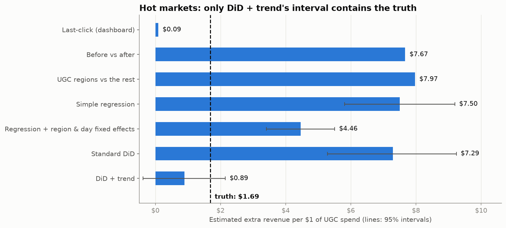
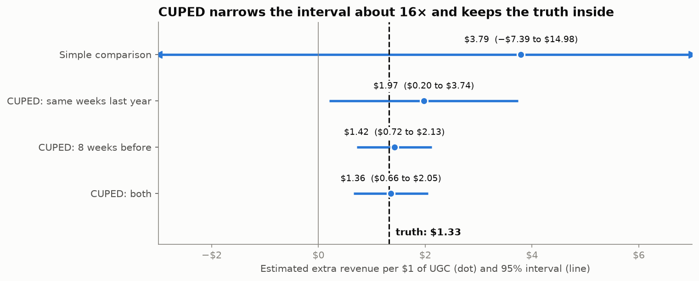

# Incrementality Lab: grading marketing measurement against a known truth

> **Work in progress.** Done: the simulated world, exploratory analysis, naive methods,
> difference-in-differences, and a power-sized randomized geo experiment.
> Next: synthetic control, a marketing mix model (MMM), and a Monte Carlo study.

**The question.** A brand runs a top-of-funnel UGC (user-generated content) campaign. How much revenue did each $1 actually *cause*?

**Why simulate.** On real data nobody knows the true answer, so nobody can tell which measurement method got it right. So I built a brand where I do know it, then ran the methods an analyst would actually use and graded each one against the truth.

The simulated brand has 50 regions × 730 days (2025–2026) of daily sales, with:
- seasonality, holidays, regional growth differences, and autocorrelated shocks that make experiments realistically noisy;
- three channels (search, social, UGC) with carryover (adstock) and saturation (Hill curves), including an S-shaped response for UGC;
- a UGC **halo** that shows up as branded-search sales;
- ad-platform reports built from clicks, not from what the ads caused;
- four spending scenarios, each with its own true answer.



## Findings so far

### Scenario 1: hot markets
The marketer launched UGC in the 20 regions that *looked* hottest. **True return: $1.69 per $1.**

| Method | Estimate per $1 | 95% interval | vs truth |
|---|---|---|---|
| Last-click (platform dashboard) | $0.09 | | about 19× too low |
| Before vs after (year over year) | $7.67 | | 4.5× too high |
| UGC regions vs the rest | $7.97 | | 4.7× too high |
| Regression on spend | $7.50 | $5.81 to $9.19 | 4.4× too high |
| Regression + region & day fixed effects | $4.46 | $3.41 to $5.51 | 2.6× too high |
| Standard difference-in-differences (DiD) | $7.29 | $5.28 to $9.24 | 4.3× too high |
| DiD + pre-trend adjustment | $0.89 | −$0.38 to $2.15 | contains the truth, but also zero |

- **Attribution and naive comparisons fail in opposite directions.** Last-click under-credits UGC and hands its halo to search (search's dashboard says $2.90 per $1; the truth is $1.16). Comparisons and regressions over-credit UGC, because the budget followed regions that were already growing.
- **The trap is visible without the answer key.** An event-study chart shows the UGC regions gaining about 9 points a year *before* launch, and a placebo launch in September 2025 makes standard DiD report a "significant" +5.9% (±2.1%) for a campaign that never happened.
- **Unclustered standard errors mislead.** In an A/A test repeated in 200 simulated worlds, ordinary standard errors flagged a significant effect for a campaign that did nothing 60% of the time; clustered by region, 8%.

### Scenario 2: randomized geo holdout
A coin flip picked 25 of 50 regions for an 8-week test. **True return: $1.33 per $1.**



- **Sized before launch.** Placebo tests on the year before showed the planned budget had only a 39% chance of detecting a $1 return. I compared levers (a 12- or 16-week test: 46–48%; 100 or 200 regions: 54–71%; a 1.7× test budget: 82%) and ran the test at 1.7×.
- **The coin flip makes it fair; CUPED makes it precise.** The simple comparison of UGC regions vs control regions is unbiased on average, but gives $3.79 (95% interval −$7.39 to $14.98). CUPED, which adjusts each region for its pre-test sales, gives **$1.42 ($0.72 to $2.13)**, an interval about 16× narrower, with the truth inside.
- **More precision can't fix an unfair comparison.** The same CUPED reading on the hot-markets data gives $4.52 ($3.06 to $5.98) against a true $1.69. Across 30 simulated worlds it averaged 3.6× the truth, and its interval contained the truth in 1 of 30.
- **Checked across 60 simulated worlds:**
  - average error +$0.05;
  - the 95% interval contained the truth 97% of the time;
  - the effect was detected 77% of the time.

  This world turned out quieter than most: its own history understated the typical noise.
- **With randomization, reasonable readings agree.** CUPED and the DiD variants are all unbiased here and differ only in precision. Without randomization (scenario 1), no formula recovers what a coin flip gives.

## Roadmap

| Section | Method | Scenario | Status |
|---|---|---|---|
| 1–5 | The simulated world | All | Done |
| 6 | Exploratory data analysis | Hot markets | Done |
| 7 | Naive methods, plus an A/A test of standard errors | Hot markets | Done |
| 8 | Difference-in-differences: pre-trend check, placebo launch, trend repair | Hot markets | Done |
| 9 | Geo experiment: power analysis, CUPED, robustness | Random holdout | Done |
| 10 | Synthetic control | Three test markets | In progress |
| 11 | MMM: diminishing-returns vs S-curve response, compared at low, typical and high budgets | Always-on flights | Planned |
| 12 | Monte Carlo study of every method | All | Planned |

## What "true return" means, and the limits

Each method is graded against all the extra revenue the UGC spend caused in that scenario (direct sales plus the branded-search halo), divided by the spend. That is an *average* return at the budget and in the regions actually used, not the return on the next dollar.

Every result depends on the simulation's assumptions: how budgets follow momentum, the shape of the head start, the response curves. The point is the mechanisms (why each method fails or works, and which warning signs an analyst can see), not a claim about any real brand.

## Repo

| File | What it is |
|---|---|
| `incrementality.ipynb` | The full analysis, written for a mixed audience: plain-language text with the code visible |
| `simulate.py` | The simulated world. Every assumption is a named setting in `WorldConfig` |
| `style.py` | Shared chart style |
| `test_simulate.py` | Sanity checks: reproducible worlds, no hidden truth in the analyst's view, sales that add up |
| `images/` | Charts used in this README, written by the notebook |

## Run it

Python 3.10 or newer.

```bash
python -m venv .venv && source .venv/bin/activate
pip install -r requirements.txt
python test_simulate.py
```

Then open `incrementality.ipynb` in VS Code or Jupyter and run all cells (about a minute).

To read the notebook without running it, GitHub's preview works, but [nbviewer](https://nbviewer.org/github/menni99/incrementality-mmm-lab/blob/main/incrementality.ipynb) is faster for a file this size.
